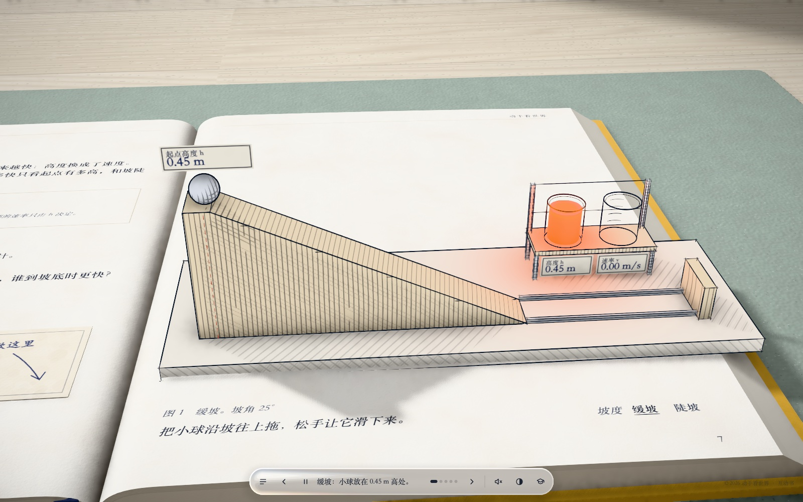
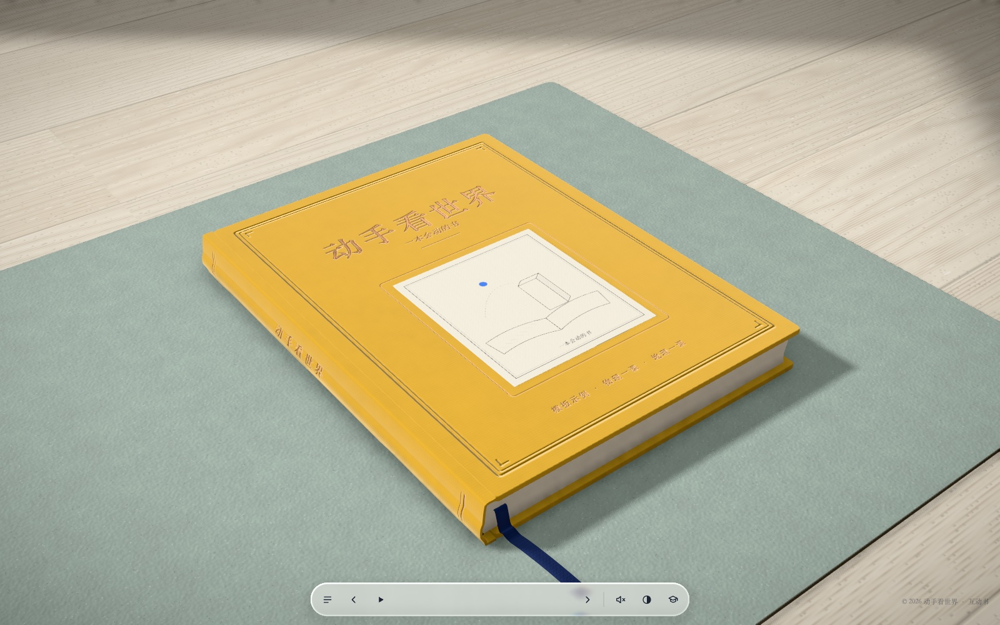
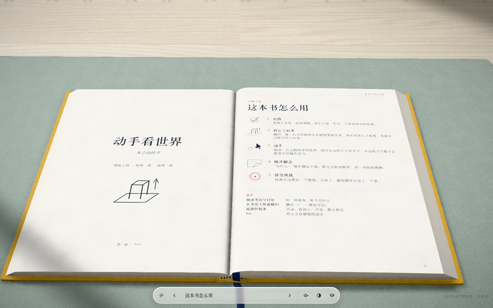
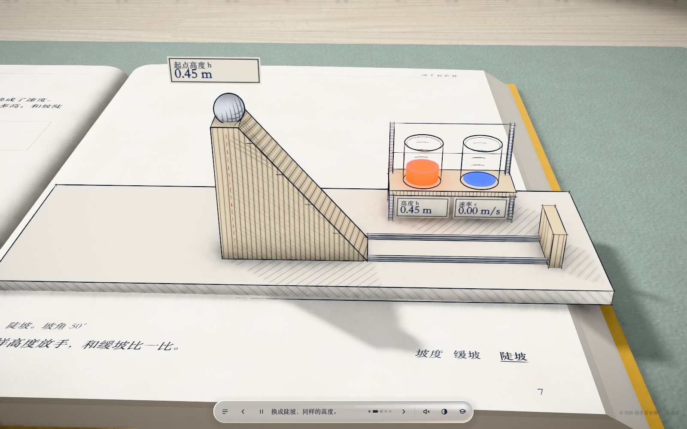
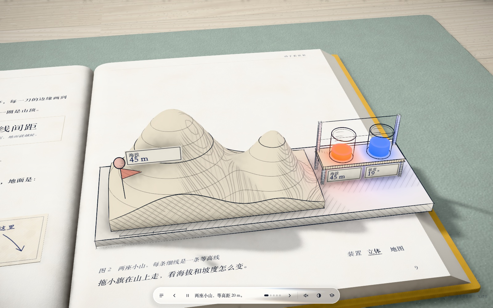
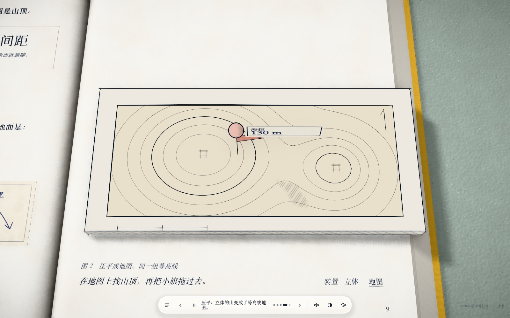
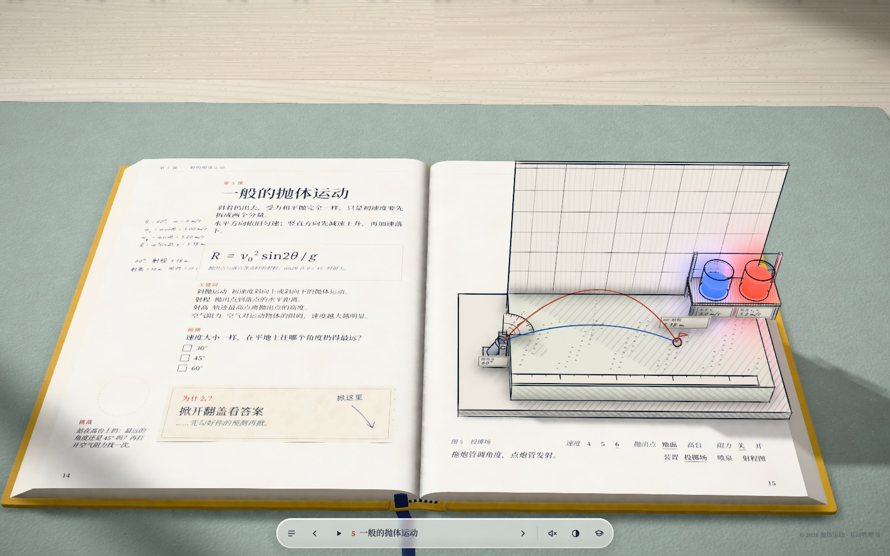

# Every Joule–style interactive book skill (every-joule-style)

[中文](README.md) | **English**

> **Unofficial reimplementation.** This engine and AI skill recreate the style of [Every Joule](https://iamtechartist.com/every-joule/) by Techartist. It is not affiliated with or endorsed by the original author. The original has no public source or license; everything here — code, text, illustrations — was written from scratch, and no code or assets from the original are used. If you like the style, go see the original first.

An AI skill that turns your own content into an Every Joule–style web book that moves.



- A realistic book lies on a wooden desk, and you can turn its pages.
- Turn to a lesson and a pen draws the figure on the right page stroke by stroke, then the figure **folds up** out of the paper into a small 3D apparatus you can drag.
- Glowing gauge cups, paper tags and handwritten "your data" in the margin update as you play.
- The left page follows **predict → try it → lift the flap for the explanation → finish the challenge and earn a stamp**.
- Contents, index, quiz, references, teacher notes, auto demo, sound and a hover magnifier are built in.

Install the skill in your AI coding assistant (Claude Code, Codex, Cursor…), then give it lesson notes, a handout, a list of ideas, or just a topic. It asks you a few questions first, then builds the book lesson by lesson and checks each one with screenshots. **Any subject works**: there are apparatus recipes for physics, chemistry, biology, geography, maths, history and languages.

## Screenshots

| | |
|---|---|
|  Closed book: cloth cover, gold-foil title |  Title page and "How to use this book" |
|  Auto demo: let go, height turns into speed |  Geography sample: terrain block with contour lines; drag the flag to read height and slope |
|  The same terrain flattened into a contour map |  A full book built on the same engine (*Projectile Motion*, in Chinese) |

## What using it looks like

You tell your AI:

> Use the every-joule-style skill to turn my handout on reaction rates into an interactive book.

> Make a moving book like Every Joule about contour lines and landforms, 3 lessons.

The AI will:

1. Read your material and draft a lesson plan.
2. **Round 1: ask 4 questions** — lesson split, title and cover colour, audience and level, which appendix pages to include. Each has a recommended default; reply "default" to accept them all.
3. **Round 2: propose an apparatus for each lesson** — what it is, what you drag or click, what the gauges measure, what the challenge is — and wait for your OK.
4. Scaffold the project, write the text and the apparatus, and check every lesson with headless-browser screenshots (overflowing text, errors and wrong readings get caught).
5. Show you lesson 1 first, and continue only when you're happy with it.
6. Build a static site (`dist/`) that works on GitHub Pages, Netlify, Vercel or any static host.

## Install

Copy the whole `skills/every-joule-style` folder to wherever your AI tool looks for skills:

| Tool | Location |
|---|---|
| Claude Code | `~/.claude/skills/every-joule-style/`, or `.claude/skills/every-joule-style/` in a project |
| Codex | `~/.codex/skills/every-joule-style/`, or `.agents/skills/every-joule-style/` in a project |
| Cursor and other Agent Skills tools | `.agents/skills/every-joule-style/` or `.cursor/skills/every-joule-style/` in a project |
| Any other AI | Paste the contents of `SKILL.md` and tell it where the skill folder is |

```bash
git clone https://github.com/james123wang5/every-joule-style.git
cp -r every-joule-style/skills/every-joule-style ~/.claude/skills/
```

Requires Node.js 20+ and Chrome, Chromium or Edge (for the screenshot checks).

## Use the template without an AI

```bash
node skills/every-joule-style/scripts/new-book.mjs my-book --title "My Book" --lang en
cd my-book && npm install && npm run dev      # http://localhost:5173 — add #3 to jump to spread 3
node tools/check.mjs --demo                   # validate content, screenshot every page, collect errors
```

Edit `config.js` (title, cover, legend, references), `lessons.js` (lesson text) and `quiz.js` under `src/content/`, and write each lesson's apparatus under `src/lessons/`. The API is documented in [`references/apparatus.md`](skills/every-joule-style/references/apparatus.md) (the skill's reference docs are in Chinese; modern AI assistants read them fine). Setting `lang: 'en'` switches every built-in label, button and appendix text to English.

## What's inside

```
skills/every-joule-style/
  SKILL.md              Main instructions for the AI: workflow and hard rules
  references/           Q&A script, content format, apparatus API, subject recipes, style guide, self-check list
  template/             Full engine (Vite + three.js) + two sample lessons (physics ramp, geography contours)
    tools/check.mjs     Content validation + headless screenshots of every page + error and layout warnings
  examples/             Apparatus code from the five-lesson projectile-motion book, for reference
  scripts/new-book.mjs  Scaffold a new book from the template
```

The engine covers: a millimetre-scale realistic desk scene (window light, procedural wood and paper, ambient occlusion, tone mapping); pages with thickness that bend and curl; a cloth cover with gold foil; pen strokes drawn one at a time (pressure, overshoot, wobble); copper-plate hatching fixed to each object; live silhouettes for spheres and lathe shapes; oblique printed figures that rise into 3D and fold back down; glowing liquids with colour spill; a liquid-glass control bar and magnifier; Chinese and English UI.

## License and credits

- Code and text: [PolyForm Noncommercial 1.0.0](skills/every-joule-style/LICENSE.md). Free to use, modify and share, **not for commercial use**.
- Sounds in `template/public/audio/` are CC0 recordings from Freesound; sources are listed in the README there.
- Fonts and libraries (three.js, postprocessing, N8AO, KaTeX, Noto Serif SC, LXGW WenKai, Source Serif 4, Caveat) are installed from npm under their own licenses.
- The style comes from [Every Joule](https://iamtechartist.com/every-joule/) by Techartist: the book layout, figures rising off the page, predict–experiment–flap, and the gauge cups were all learned from it. This is an unofficial recreation; all code, text and illustrations were written from scratch with no code or assets from the original. Please don't publish books made with this skill under the Every Joule name.
