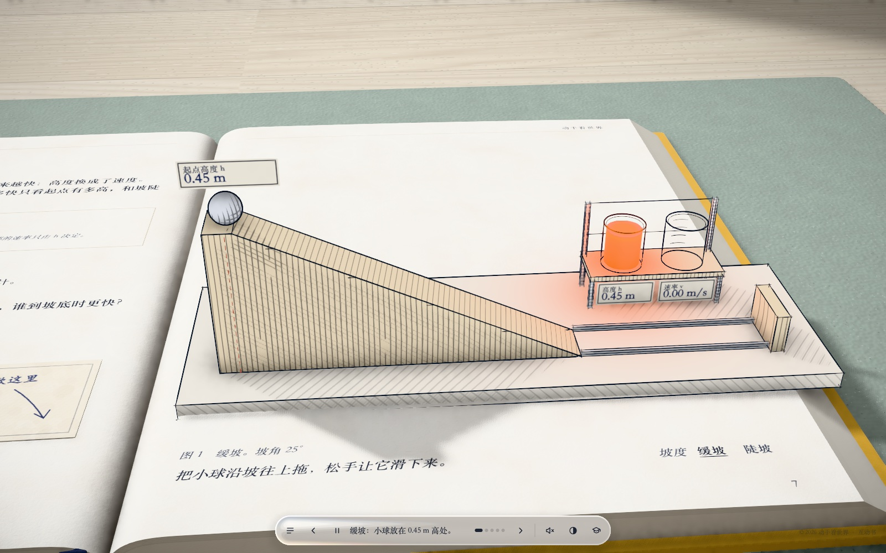
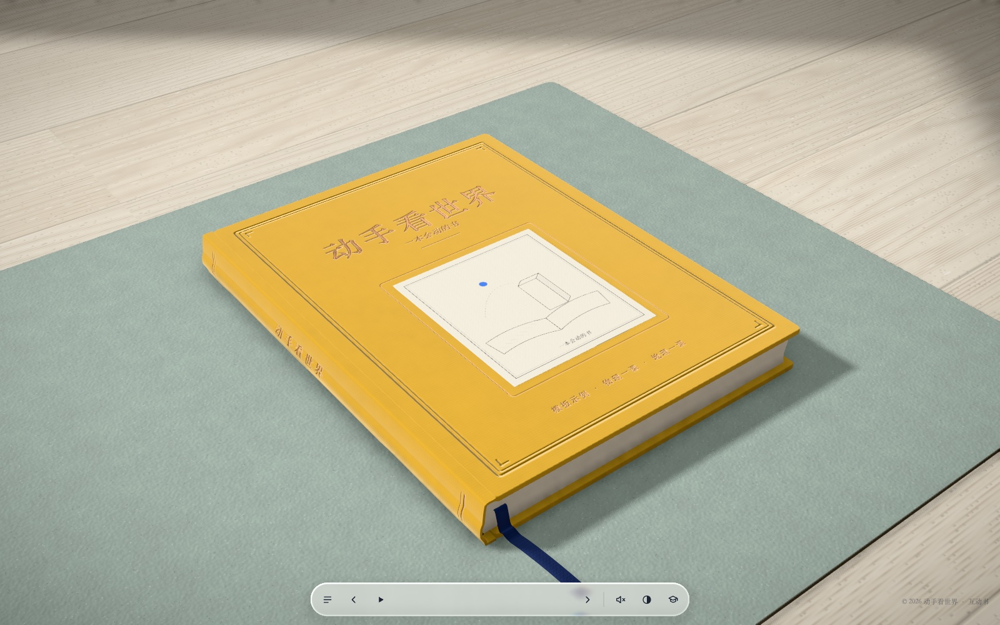
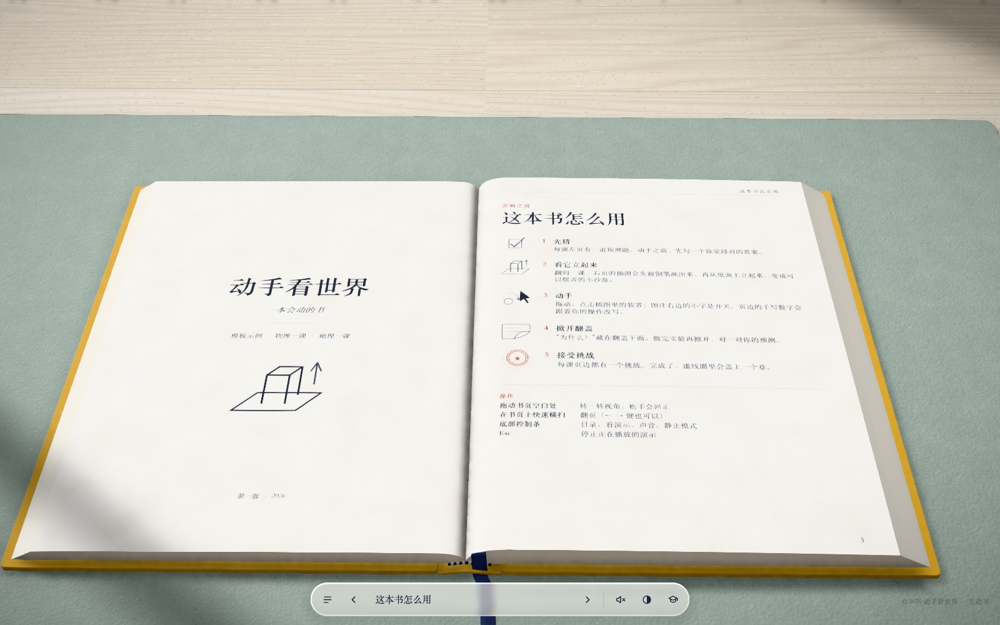
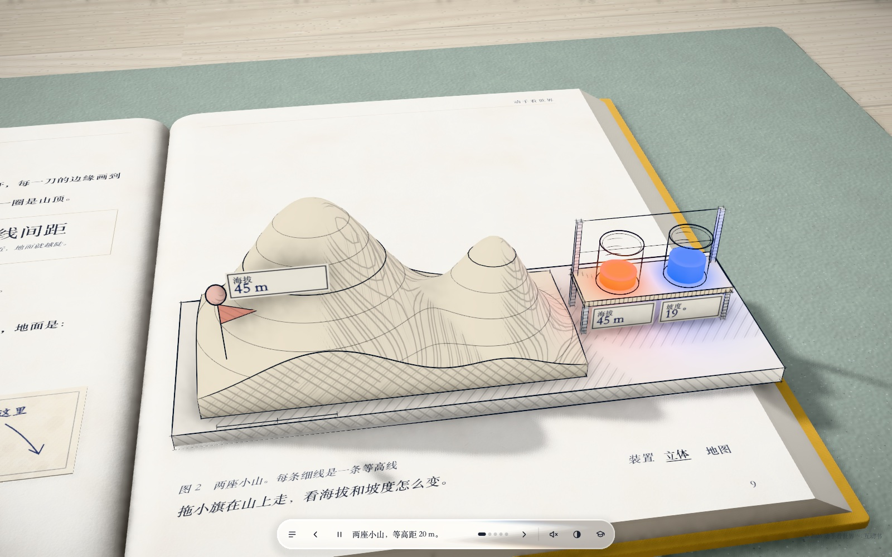
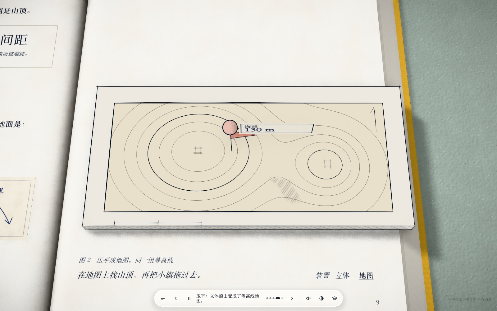
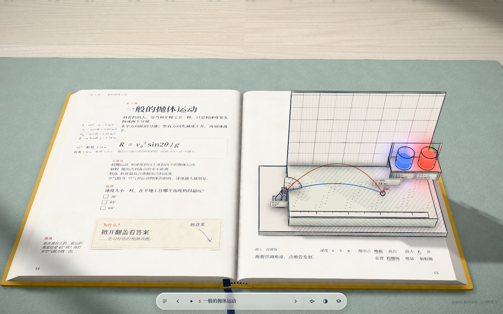

# inkfold · 墨线立体互动书

**中文** | [English](README.en.md)

一个 AI skill：把你自己的内容做成一本“会动的书”网页。



- 写实的书摆在木桌上，可以翻页；
- 翻到一课，右页的插图先被钢笔一笔一笔画在纸上，再从纸面**立起来**，变成可以拖动的 3D 小装置；
- 发光的读数杯、纸签、页边手写的“你的数据”跟着你的操作实时变化；
- 左页是“**先预测 → 动手试 → 掀开翻盖看解释 → 完成挑战盖章**”；
- 自带目录、索引、测验、参考来源、给老师的话、自动演示、音效、鼠标放大镜。

把这个 skill 装进你的 AI 编程助手（Claude Code、Codex、Cursor……），给它课文、讲义、知识点，或者只说一个主题。它会先问你几个问题，再一课一课地做出来，每课自己截图检查。**任何学科都能用**：物理、化学、生物、地理、数学、历史、语文都有现成的装置配方。

## 截图

| | |
|---|---|
|  合着的书：布面封面、烫金书名 |  扉页和“这本书怎么用” |
|  自动演示：松手，高度换成速度 |  地理示例：带等高线的地形块，拖小旗读海拔和坡度 |
|  同一块地形压平成等高线地图 |  用同一套引擎打磨的完整书《抛体运动》 |

## 用起来是什么样

你对 AI 说：

> 用 inkfold，把我这份《化学反应速率》讲义做成互动书。

> 做一本像 Every Joule 那样会动的书，讲初中地理的等高线和地形，3 课。

AI 会：

1. 读你的材料，拟一个分课表；
2. **第一轮问 4 个问题**：分课、书名和封面颜色、读者和难度、附页要哪些。每题都有推荐默认值，回复“默认”就全按推荐来；
3. **第二轮列出每课的装置方案**：装置是什么、怎么动手、读什么数、挑战是什么。等你确认再动手；
4. 建项目、写文字、写装置，每课用无头浏览器截图自查（排版放不下、报错、读数不对都会被查出来）；
5. 先把第 1 课给你看，满意后再做其余各课；
6. 最后打包成纯静态网页（`dist/`），放到 GitHub Pages、Netlify、Vercel 等任何地方都能打开。

## 安装

把 `skills/inkfold` 整个文件夹复制到你的 AI 工具读取 skill 的位置：

| 工具 | 位置 |
|---|---|
| Claude Code | `~/.claude/skills/inkfold/`，或项目里的 `.claude/skills/inkfold/` |
| Codex | `~/.codex/skills/inkfold/`，或项目里的 `.agents/skills/inkfold/` |
| Cursor 等支持 Agent Skills 的工具 | 项目里的 `.agents/skills/inkfold/` 或 `.cursor/skills/inkfold/` |
| 其他 AI | 把 `SKILL.md` 的内容贴给它，并告诉它 skill 文件夹在哪里 |

```bash
git clone https://github.com/james123wang5/inkfold.git
cp -r inkfold/skills/inkfold ~/.claude/skills/
```

需要 Node.js 20 以上，以及 Chrome / Chromium / Edge 任意一个（自查截图用）。

## 不用 AI，直接用模板

```bash
node skills/inkfold/scripts/new-book.mjs my-book --title "我的书" --lang zh
cd my-book && npm install && npm run dev      # http://localhost:5173 ，网址加 #3 直接翻到第 3 个跨页
node tools/check.mjs --demo                   # 检查内容格式、逐页截图、收集报错
```

改 `src/content/` 下的 `config.js`（书名、封面、图例、来源）、`lessons.js`（每课文字）、`quiz.js`（测验），在 `src/lessons/` 下写每课的装置。接口说明见 [`references/apparatus.md`](skills/inkfold/references/apparatus.md)。

## 里面有什么

```
skills/inkfold/
  SKILL.md              AI 读的主说明：工作流程和必须遵守的规则
  references/           问答清单、内容格式、写装置的接口、各学科配方、风格规范、自查清单
  template/             完整引擎（Vite + three.js）+ 两课示例（物理“滑下斜坡”、地理“等高线”）
    tools/check.mjs     内容校验 + 无头浏览器逐页截图 + 报错和排版警告
  examples/             《抛体运动》五课的装置代码，给 AI 参考写法
  scripts/new-book.mjs  用模板建一本新书
```

引擎做了：毫米单位的写实书桌场景（窗光、程序生成的木纹和纸张、环境光遮蔽、色调映射）；有厚度、会弯会卷角的书页；布面烫金封面；逐笔画出的钢笔线（粗细起伏、出头、抖动）；固定在物体上的铜版画式排线；回转体和球的实时轮廓；斜投影印刷图立成 3D 再折回；发光液体和溢光；液态玻璃控制条和放大镜；中英文界面。

## 许可证和致谢

- 程序和文字：[PolyForm Noncommercial 1.0.0](skills/inkfold/LICENSE.md)。可以免费使用、修改、分享，**不能用于商业用途**。
- `template/public/audio/` 的音效是 Freesound 上的 CC0 录音，出处见那里的 README。
- 字体和程序库（three.js、postprocessing、N8AO、KaTeX、Noto Serif SC、霞鹜文楷、Source Serif 4、Caveat）通过 npm 安装，各自按自己的许可证使用。
- 版式和“插图从纸面立起来”的想法受 [Every Joule](https://iamtechartist.com/every-joule/)（Techartist）启发。这里的代码、文字、插图都是重新写的，没有使用原作的代码和素材。
